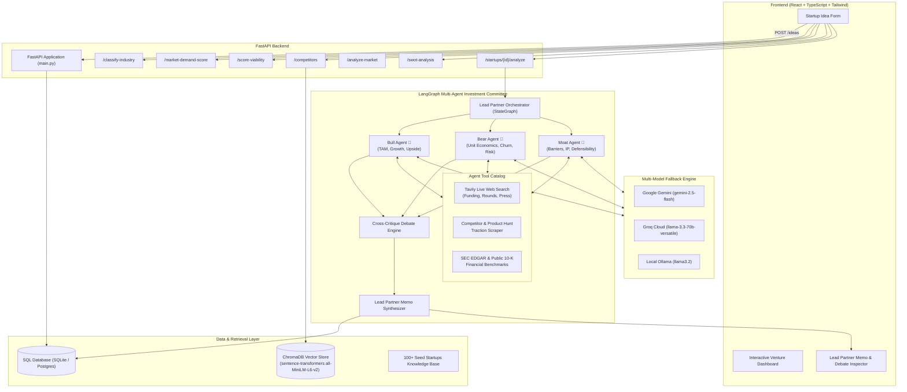

# VentureMind AI — Autonomous Startup Intelligence & Investment Committee

[](https://fastapi.tiangolo.com)
[](https://react.dev)
[](https://www.typescriptlang.org)
[](https://www.langchain.com)
[](https://langchain-ai.github.io/langgraph/)
[](https://www.trychroma.com)
[](https://tailwindcss.com)

**VentureMind AI** is an AI-powered venture intelligence platform that stress-tests startup ideas. It moves beyond generic chat prompts by coupling **deterministic scoring engines** and **semantic vector retrieval (RAG)** with a **LangGraph-orchestrated Multi-Agent Investment Committee** that deliberates, debates, executes live web & financial research, and produces an institutional-grade Lead Partner Investment Memo.

---

## 🏛️ System Architecture

The platform combines deterministic algorithmic evaluators, vector similarity search, and autonomous multi-agent consensus:



---

## ⚡ Core Features

### 1. Startup Idea Ingestion & Persistence
* **Endpoint**: `POST /ideas`, `GET /health`
* Persists startup submissions (`title`, `description`, `industry`) using SQLAlchemy ORM with automated SQLite or PostgreSQL schema migration.
* Serves as the primary entity record linked to investment memos and analysis runs.

### 2. Pure-Logic NLP Industry Classifier
* **Endpoint**: `POST /classify-industry`
* High-velocity, zero-dependency tokenization and n-gram classifier that predicts the target sector (`EdTech`, `FinTech`, `HealthTech`, `AgriTech`, `SaaS`, `E-commerce`) with confidence scoring.
* Operates completely decoupled from external LLMs and databases for instant input assistance.

### 3. Quantitative Startup Viability Scoring Engine
* **Endpoint**: `POST /score-viability`
* Multi-factor mathematical scoring model computing an explainable 0–100 score:
  $$\text{Upside} = 0.30 \times \text{Demand} + 0.20 \times (100 - \text{Competition}) + 0.25 \times \text{Scalability} + 0.15 \times \text{Innovation}$$
  $$\text{Final Score} = \text{Upside} \times (1.0 - 0.003 \times \text{Risk})$$
* Returns rating bands (`Exceptional`, `High`, `Moderate`, `Low`, `Poor`), factor contributions, points lost, and executive scoring summaries.

### 4. Market Demand Scoring Engine
* **Endpoint**: `POST /market-demand-score`
* Evaluates market appetite by weighting industry TAM baselines, competitor concentration penalties, search trend momentum, and annual market growth rates.
* Seamlessly pipes its 0–100 result directly into the viability scoring pipeline.

### 5. Semantic Competitor Retrieval (RAG via ChromaDB)
* **Endpoint**: `POST /competitors`
* Employs `sentence-transformers/all-MiniLM-L6-v2` embeddings in a persistent ChromaDB instance.
* Retrieves top-K closest competitors with normalized cosine similarity ($[0, 1]$) from a pre-indexed 100+ startup database.

### 6. Grounded Gemini Market Analysis
* **Endpoint**: `POST /analyze-market`
* Combines ChromaDB vector retrieval with Google Gemini structured generation.
* Eliminates hallucinations by strictly constraining market summaries, competitor positioning, and direct differentiators to the retrieved startup documents.

### 7. 4-Quadrant SWOT Analysis Matrix
* **Endpoint**: `POST /swot-analysis`
* Produces a structured SWOT breakdown (Strengths, Weaknesses, Opportunities, Threats) with detailed rationale per bullet.
* Evaluates context sufficiency to warn the user if an idea description lacks necessary depth.

### 8. LangGraph Multi-Agent Investment Committee
* **Endpoints**: `POST /startups/{id}/analyze`, `GET /startups/{id}/memo`, `POST /tools/web-search`
* Coordinated by `LeadPartnerOrchestrator` using a compiled LangGraph `StateGraph`:
  1. **Parallel Partner Deliberation**:
     * **Bull Agent 🐂**: Investigates venture-scale upside, TAM expansion, market tailwinds, and aggressive monetization paths.
     * **Bear Agent 🐻**: Stress-tests unit economics, CAC payback, churn, customer concentration, and execution pitfalls.
     * **Moat Agent 🏰**: Evaluates defensibility, proprietary data flywheels, IP barriers, and switching friction.
  2. **Live Intelligence Tools**:
     * `web_search_intel`: Queries Tavily Search API for real-time funding rounds, competitor press, and venture headlines.
     * `lookup_competitor_traction`: Scrapes Product Hunt community stats, upvote benchmarks, and pricing tiers.
     * `lookup_sec_edgar_tam`: Pulls public comp 10-K benchmarks (gross margin medians, Rule of 40, S&M ratios) from SEC EDGAR.
     * **Execution Tracing**: Every tool invocation logs start time, inputs, runtime latency (ms), status, and returned findings.
  3. **Cyclic Debate Node (`run_debate`)**:
     * Multi-agent cross-examination round where committee members directly challenge opposing assumptions.
  4. **Lead Partner Synthesis & Caching**:
     * Produces consensus score, verdict (`STRONG INVEST`, `INVEST WITH CONDITIONS`, `CAUTION / PASS`, `PASS`), executive summary, key risks, strengths, and actionable recommendations.
     * Cached in the `investment_memos` database table with instant retrieval.
  5. **Unified Multi-Model Fallback Architecture**:
     * Idiomatic LangChain `ModelFallbackMiddleware` fails over smoothly across **Google Gemini**, **Groq Cloud**, and local **Ollama** (`llama3.2`).

---

## 💻 Tech Stack

| Layer | Technologies |
| :--- | :--- |
| **Backend Framework** | [FastAPI](https://fastapi.tiangolo.com/) 0.115, Uvicorn, Python 3.11 |
| **Agentic & Orchestration** | [LangChain](https://www.langchain.com/) 0.3, [LangGraph](https://langchain-ai.github.io/langgraph/) 0.2 |
| **AI Models & Providers** | Google Gemini (`gemini-2.5-flash`), Groq (`llama-3.3-70b`), Ollama (`llama3.2`) |
| **External Intelligence** | Tavily Search API, Serper Google API, SEC EDGAR 10-K Data |
| **Vector DB & Embeddings** | [ChromaDB](https://www.trychroma.com/) 1.5, `sentence-transformers` (`all-MiniLM-L6-v2`) |
| **Database & ORM** | SQLite (default dev), PostgreSQL (production-ready), SQLAlchemy 2.0 |
| **Frontend Framework** | [React 18](https://react.dev/), [Vite](https://vitejs.dev/), TypeScript 5.5 |
| **Styling & Icons** | [Tailwind CSS 3.4](https://tailwindcss.com/), PostCSS, Autoprefixer |
| **Testing** | Pytest 9.1, AnyIO, Unittest |

---

## 📂 Repository Structure

```
Foundq/
├── .gitignore                          # Clean production gitignore
├── PROJECT_SCOPE.md                    # Project roadmap, design scope & milestones
├── README.md                           # Main project documentation
├── startup_knowledge_base.csv          # 100+ Curated startups dataset
├── startup_knowledge_base.jsonl        # JSONL format dataset
├── startup_knowledge_base_enriched.csv # Extended dataset with website & geography
└── venturemind/
    ├── README.md                       # Component-level quickstart
    ├── db/
    │   └── schema.sql                  # PostgreSQL / SQLite DDL schema
    ├── backend/
    │   ├── requirements.txt            # Python dependencies
    │   ├── .env.example                # Safe environment variable template
    │   ├── app/
    │   │   ├── main.py                 # FastAPI application factory & routes
    │   │   ├── config.py               # Pydantic Settings configuration
    │   │   ├── database.py             # Database engine & session dependency
    │   │   ├── models.py               # SQLAlchemy models (Idea, InvestmentMemo)
    │   │   ├── schemas.py              # Pydantic v2 schemas
    │   │   ├── crud.py                 # Database CRUD operations
    │   │   ├── routers/
    │   │   │   ├── classify.py         # Industry classification router
    │   │   │   ├── score.py            # Viability scoring router
    │   │   │   ├── market_demand.py    # Market demand router
    │   │   │   ├── analyze.py          # Grounded market analysis & Committee router
    │   │   │   └── swot.py             # SWOT analysis router
    │   │   ├── services/
    │   │   │   ├── industry_classifier.py  # NLP classifier engine
    │   │   │   ├── viability_scorer.py     # Viability 5-factor mathematical model
    │   │   │   ├── market_demand.py        # Market demand scoring model
    │   │   │   ├── market_analyzer.py      # Grounded Gemini analysis service
    │   │   │   ├── swot_analyzer.py        # SWOT generation service
    │   │   │   ├── llm_client.py           # Multi-provider LLM adapter (Gemini/Groq/Ollama)
    │   │   │   ├── debate.py               # LangGraph cyclic multi-agent debate
    │   │   │   ├── memo_writer.py          # Lead partner memo synthesis
    │   │   │   └── agents/                 # Committee agent implementations
    │   │   │       ├── base.py             # Base agent & ModelFallbackMiddleware factory
    │   │   │       ├── bull_agent.py       # Bull Agent definition
    │   │   │       ├── bear_agent.py       # Bear Agent definition
    │   │   │       ├── moat_agent.py       # Moat Agent definition
    │   │   │       ├── orchestrator.py     # LangGraph LeadPartnerOrchestrator
    │   │   │       └── tools.py            # Tavily, Product Hunt, SEC EDGAR tools
    │   │   ├── prompts/                    # System prompt templates
    │   │   │   ├── bull_agent.txt
    │   │   │   ├── bear_agent.txt
    │   │   │   ├── moat_agent.txt
    │   │   │   ├── orchestrator.txt
    │   │   │   └── final_memo.txt
    │   │   └── rag/                        # Semantic vector retrieval
    │   │       ├── chroma_client.py        # Chroma persistent client & collection
    │   │       ├── embeddings.py           # Sentence-transformers embedding function
    │   │       ├── ingestion.py            # RAG data ingestion script
    │   │       └── retrieval.py            # Nearest-neighbor semantic search
    │   └── tests/                          # Comprehensive Pytest test suite
    │       ├── test_ideas.py
    │       ├── test_classify.py
    │       ├── test_viability.py
    │       ├── test_market_demand.py
    │       ├── test_swot.py
    │       ├── test_analyze.py
    │       ├── test_committee.py
    │       ├── test_langgraph_debate.py
    │       ├── test_agent_tools.py
    │       ├── test_agent_fallback_middleware.py
    │       ├── test_tavily_search.py
    │       └── test_ollama.py
    └── frontend/
        ├── package.json                    # NPM dependencies & scripts
        ├── vite.config.ts                  # Vite build configuration
        ├── tailwind.config.js              # Tailwind styling config
        ├── .env.example                    # Frontend API URL configuration
        └── src/
            ├── main.tsx                    # React entrypoint
            ├── App.tsx                     # Root App component
            ├── types.ts                    # TypeScript types mirroring API schemas
            ├── api/                        # HTTP client modules
            │   ├── ideas.ts
            │   ├── competitors.ts
            │   ├── swot.ts
            │   ├── marketDemand.ts
            │   ├── viability.ts
            │   └── investmentMemo.ts
            ├── components/                 # UI Components
            │   ├── Dashboard.tsx           # Main workspace view
            │   ├── IdeaForm.tsx            # Sticky startup submission form
            │   ├── InvestmentMemoSection.tsx # Deliberation, memo & tool inspector
            │   ├── CompetitorsSection.tsx  # Competitor list & similarity cards
            │   ├── CompetitorCard.tsx      # Individual competitor card
            │   ├── SwotSection.tsx         # 4-quadrant SWOT container
            │   ├── SwotQuadrant.tsx        # Individual quadrant display
            │   ├── MarketDemandSection.tsx # Demand score & factor breakdown
            │   ├── DemandMeter.tsx         # Visual gauge meter for demand
            │   ├── ViabilityScoreSection.tsx # Viability score & factor progress
            │   └── ScoreGauge.tsx          # Radial SVG score gauge
            └── hooks/
                └── useAsync.ts             # Generic async state management hook
```

---

## 🚀 Quickstart Guide

### 1. Prerequisites
* **Python**: 3.10+ (tested on Python 3.11)
* **Node.js**: 18+ and npm
* *(Optional)* **Ollama**: If running local offline models (`ollama run llama3.2`)

---

### 2. Backend Setup

```bash
cd venturemind/backend

# 1. Create and activate a virtual environment
python -m venv .venv
# On Windows:
.venv\Scripts\activate
# On Linux/macOS:
source .venv/bin/activate

# 2. Install dependencies
pip install -r requirements.txt

# 3. Configure environment variables
cp .env.example .env
# Edit .env with your keys (or use local defaults with SQLite)
```

#### Key `.env` Configuration Options:
```ini
# Database: SQLite for instant local dev, or PostgreSQL for production
DATABASE_URL=sqlite:///./venturemind.db

# CORS configuration
CORS_ORIGINS=http://localhost:5173,http://127.0.0.1:5173

# Cloud LLM Keys (Optional - gracefully falls back if omitted)
GEMINI_API_KEY=your_gemini_api_key_here
GEMINI_MODEL=gemini-2.5-flash
GROQ_API_KEY=your_groq_api_key_here
GROQ_MODEL=llama-3.3-70b-versatile

# Real-Time Intelligence Search Keys (Optional)
TAVILY_API_KEY=your_tavily_api_key_here
SERPER_API_KEY=your_serper_api_key_here

# Local Ollama Fallback Settings
OLLAMA_BASE_URL=http://localhost:11434
OLLAMA_MODEL=llama3.2
```

#### Run the Backend Server:
```bash
uvicorn app.main:app --reload --port 8000
```
Interactive OpenAPI documentation will be accessible at [http://localhost:8000/docs](http://localhost:8000/docs).

---

### 3. Frontend Setup

```bash
cd venturemind/frontend

# 1. Install dependencies
npm install

# 2. Setup environment
cp .env.example .env

# 3. Launch Vite development server
npm run dev
```
Open your browser at [http://localhost:5173](http://localhost:5173).

---

### 4. Running Tests

The test suite covers algorithmic scoring, NLP classification, RAG retrieval, agent fallbacks, and mock committee debates:

```bash
cd venturemind/backend
pytest -v
```

---

## 📡 REST API Reference

| Method | Endpoint | Description |
| :--- | :--- | :--- |
| `GET` | `/health` | Application liveness and readiness probe |
| `POST` | `/ideas` | Submit and persist a new startup idea |
| `POST` | `/classify-industry` | Fast token-based industry classifier |
| `POST` | `/score-viability` | Compute 0–100 viability score with 5-factor breakdown |
| `POST` | `/market-demand-score` | Compute 0–100 market demand score |
| `POST` | `/competitors` | Retrieve top-K similar startups via ChromaDB semantic search |
| `POST` | `/analyze-market` | Grounded competitor and market analysis via Gemini RAG |
| `POST` | `/swot-analysis` | 4-quadrant SWOT matrix generation |
| `POST` | `/startups/{id}/analyze` | Execute LangGraph Multi-Agent Investment Committee deliberation |
| `GET` | `/startups/{id}/memo` | Retrieve cached Lead Partner Investment Memo for a startup |
| `POST` | `/tools/web-search` | Live Tavily/Serper market and funding intelligence search |

---

## 🛡️ License

This project is licensed under the MIT License.
