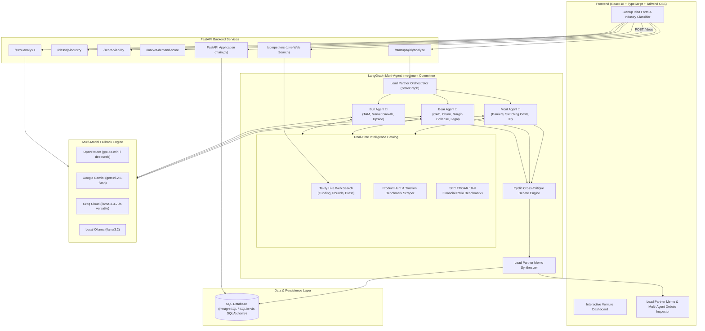

# VentureMind AI — Autonomous Startup Intelligence & Investment Committee

[](https://fastapi.tiangolo.com)
[](https://react.dev)
[](https://www.typescriptlang.org)
[](https://www.langchain.com)
[](https://langchain-ai.github.io/langgraph/)
[](https://tailwindcss.com)
[](https://render.com)
[](https://vercel.com)

**VentureMind AI** is an institutional-grade venture intelligence platform that stress-tests and audits startup concepts. Moving beyond superficial LLM chat prompts, it couples **deterministic mathematical scoring engines** and **live real-time web competitor discovery** with a **LangGraph-orchestrated Multi-Agent Investment Committee** that deliberates, cross-examines peer assumptions in cyclic debate, and synthesizes an institutional Lead Partner Investment Memo.

---

## 🏛️ System Architecture

The platform unifies deterministic evaluators, autonomous web research, and cyclic multi-agent debate consensus:



---

## ⚡ Core Platform Capabilities

### 1. Startup Idea Ingestion & Persistence
* **Endpoint**: `POST /ideas`, `GET /health`
* Persists startup submissions (`title`, `description`, `industry`) via SQLAlchemy ORM with automatic SQLite and PostgreSQL table lifecycle handling.
* Serves as the immutable entity record bound to investment memos, SWOT runs, and historical evaluations.

### 2. Pure-Logic NLP Industry Classifier
* **Endpoint**: `POST /classify-industry`
* High-velocity, zero-dependency tokenization and n-gram classifier that predicts target sectors (`EdTech`, `FinTech`, `HealthTech`, `AgriTech`, `SaaS`, `E-commerce`) with confidence scoring.
* Runs completely in-memory without external model overhead or network latency for instant form UX.

### 3. Quantitative Startup Viability Scoring Engine
* **Endpoint**: `POST /score-viability`
* Multi-factor mathematical evaluation model computing an explainable 0–100 score:
  $$\text{Upside} = 0.30 \times \text{Demand} + 0.20 \times (100 - \text{Competition}) + 0.25 \times \text{Scalability} + 0.15 \times \text{Innovation}$$
  $$\text{Final Score} = \text{Upside} \times (1.0 - 0.003 \times \text{Risk})$$
* Returns rating bands (`Exceptional`, `High`, `Moderate`, `Low`, `Poor`), factor weight contributions, points lost, and executive scoring summaries.

### 4. Market Demand Scoring Engine
* **Endpoint**: `POST /market-demand-score`
* Evaluates market appetite by weighting industry TAM baselines, competitor concentration penalties, search trend momentum, and annual market growth rates.

### 5. Live Web Competitor Intelligence (Autonomous Web Discovery)
* **Endpoint**: `POST /competitors`
* Dynamically extracts active market competitors, pricing models, and direct alternatives directly from the live web using Tavily Search + LLM entity extraction.
* Bypasses outdated static vector caches to deliver fresh competitive intelligence.

### 6. 4-Quadrant SWOT Analysis Matrix
* **Endpoint**: `POST /swot-analysis`
* Produces an institutional SWOT matrix (Strengths, Weaknesses, Opportunities, Threats) with structured bullet explanations and context-sufficiency validation.

### 7. LangGraph Multi-Agent Investment Committee & Cyclic Debate
* **Endpoints**: `POST /startups/{id}/analyze`, `GET /startups/{id}/memo`
* Coordinated by `LeadPartnerOrchestrator` using a compiled LangGraph `StateGraph`:
  1. **Parallel Partner Deliberation**:
     * **Bull Agent 🐂**: Investigates venture-scale upside, TAM expansion, market tailwinds, and aggressive monetization paths.
     * **Bear Agent 🐻**: Stress-tests unit economics, CAC payback, churn, customer concentration, and execution pitfalls.
     * **Moat Agent 🏰**: Evaluates defensibility, proprietary data flywheels, IP barriers, and switching friction.
  2. **Cyclic Debate Node (`run_debate`)**:
     * Multi-agent cross-examination round where committee members directly challenge opposing assumptions.
  3. **Lead Partner Synthesis & Caching**:
     * Synthesizes peer friction into a consensus score, verdict (`INVEST`, `INVEST WITH CONDITIONS`, `CAUTION / PASS`, `PASS`), executive summary, key risks, strengths, and diligence milestones.
     * Automatically caches the output in the database for instant retrieval.
  4. **Multi-Model Fallback Engine**:
     * Automatically cascades across **OpenRouter**, **Google Gemini**, **Groq Cloud**, and local **Ollama** if any provider experiences rate limits or downtime.

---

## 🎙️ Sample Multi-Agent Debate Simulation

Here is an authentic simulation of the LangGraph committee reviewing a clinical AI startup:

```
[Startup Under Review]: CarePulse AI — Ambient clinical voice AI generating EHR notes & auto-submitting prior-authorization claims.

🐂 BULL AGENT (Score: 8.5/10):
"Healthcare administrative waste costs $400B annually, with physicians spending 2 hours on EHR charts 
for every hour of patient care. CarePulse’s addition of prior-authorization automation creates an immediate 
ROI for clinics by cutting claim rejection rates by 40%. Market expansion potential is massive."

🐻 BEAR AGENT (Score: 3.5/10):
"This is a lethal regulatory and sales trap. Hospital sales cycles average 9–14 months, HIPAA compliance 
overhead is severe, and Epic/Oracle Health are already rolling out native ambient AI scribes (e.g. Nuance/DAX Copilot). 
CarePulse risks high physician churn the moment an EHR vendor updates their API."

🏰 MOAT AGENT (Score: 5.0/10):
"Clinical voice transcription has become a commoditized LLM wrapper; the real defensibility lies entirely 
in the proprietary prior-authorization rules engine. Without direct EHR integration partnerships, there are 
zero switching costs."

--- CYCLIC DEBATE ROUND ---

🐻 BEAR AGENT -> BULL AGENT:
"The Bull's TAM projections ignore the unit economics of hospital procurement. Customer Acquisition Cost (CAC) 
for clinic networks is brutally high. How does CarePulse survive an 11-month sales cycle on seed capital when Epic 
can bundle a native ambient scribe for free?"

🐂 BULL AGENT -> BEAR AGENT:
"The Bear wrongly equates small outpatient clinics with enterprise hospital systems. CarePulse targets independent 
specialty practices who despise Epic's million-dollar setup fees and want self-serve onboarding. Furthermore, automated 
prior-authorization generates direct revenue recovery for doctors, shifting this from a discretionary scribe tool 
to an indispensable revenue-cycle engine."

--- LEAD PARTNER SYNTHESIS ---
Verdict: PROCEED WITH CAUTION (Series Seed) | Blended Viability: 68/100
"CarePulse is not defensible as an ambient scribe alone, but has compelling product-market fit if positioned 
as a Revenue Recovery & Prior-Authorization Engine for outpatient clinics. Diligence condition: Verify API 
independence from Epic/Cerner App Orchard partnerships."
```

---

## 💻 Tech Stack

| Layer | Technologies |
| :--- | :--- |
| **Backend Framework** | [FastAPI](https://fastapi.tiangolo.com/) 0.115, Uvicorn, Python 3.11 |
| **Agentic Orchestration** | [LangChain](https://www.langchain.com/) 0.3, [LangGraph](https://langchain-ai.github.io/langgraph/) 0.2 |
| **AI Models & Fallbacks** | OpenRouter, Google Gemini (`gemini-2.5-flash`), Groq (`llama-3.3-70b`), Ollama (`llama3.2`) |
| **External Intelligence** | Tavily Search API, Serper Google API, SEC EDGAR 10-K Data |
| **Database & ORM** | PostgreSQL (Production), SQLite (Local Dev), SQLAlchemy 2.0 |
| **Frontend Framework** | [React 18](https://react.dev/), [Vite](https://vitejs.dev/), TypeScript 5.5 |
| **Styling & UI** | [Tailwind CSS 3.4](https://tailwindcss.com/), PostCSS, Lucide Icons |
| **Testing** | Pytest 9.1, AnyIO, Unittest |
| **Deployment** | Render (FastAPI + PostgreSQL), Vercel (Edge SPA) |

---

## 📂 Repository Structure

```
Foundq/
├── .github/                            # CI/CD Workflows
├── .gitignore                          # Clean production gitignore
├── .python-version                     # Python 3.11.9 pinned for cloud builders
├── render.yaml                         # 1-Click Render Blueprint (Backend + PostgreSQL)
├── PROJECT_SCOPE.md                    # Roadmap & engineering specifications
├── README.md                           # Main repository documentation
├── startup_knowledge_base.csv          # Curated startup benchmarks dataset
└── venturemind/
    ├── README.md                       # Component quickstart
    ├── db/
    │   └── schema.sql                  # PostgreSQL & SQLite schema DDL
    ├── backend/
    │   ├── Procfile                    # Cloud process runner
    │   ├── runtime.txt                 # Python runtime specification
    │   ├── requirements.txt            # Streamlined Python dependencies
    │   ├── .env.example                # Backend environment template
    │   ├── app/
    │   │   ├── main.py                 # FastAPI application factory & routes
    │   │   ├── config.py               # Pydantic Settings configuration
    │   │   ├── database.py             # Database engine & Postgres URL normalizer
    │   │   ├── models.py               # SQLAlchemy models (Idea, InvestmentMemo)
    │   │   ├── schemas.py              # Pydantic v2 schemas
    │   │   ├── crud.py                 # Database CRUD operations
    │   │   ├── routers/
    │   │   │   ├── classify.py         # Industry detection router
    │   │   │   ├── score.py            # Viability scoring router
    │   │   │   ├── market_demand.py    # Market demand scoring router
    │   │   │   ├── analyze.py          # Investment Committee analyze router
    │   │   │   └── swot.py             # SWOT analysis router
    │   │   ├── services/
    │   │   │   ├── web_competitor_search.py # Live web competitor discovery (Tavily)
    │   │   │   ├── industry_classifier.py   # Pure-logic NLP classifier
    │   │   │   ├── viability_scorer.py      # Viability 5-factor mathematical model
    │   │   │   ├── market_demand.py         # Market demand scoring model
    │   │   │   ├── swot_analyzer.py         # SWOT generation service
    │   │   │   ├── llm_client.py            # Multi-provider LLM adapter
    │   │   │   ├── debate.py                # LangGraph cyclic multi-agent debate
    │   │   │   ├── memo_writer.py           # Lead partner memo synthesis
    │   │   │   └── agents/                  # Bull, Bear, Moat, Orchestrator & Tools
    │   │   │       ├── base.py
    │   │   │       ├── bull_agent.py
    │   │   │       ├── bear_agent.py
    │   │   │       ├── moat_agent.py
    │   │   │       ├── orchestrator.py
    │   │   │       └── tools.py
    │   │   └── prompts/                     # Agent persona prompt templates
    │   └── tests/                           # Pytest test suite
    └── frontend/
        ├── package.json
        ├── vite.config.ts
        ├── vercel.json                      # Vercel SPA redirect rules
        ├── tailwind.config.js
        ├── .env.example
        └── src/
            ├── api/                         # Frontend API clients
            ├── components/                  # Dashboard, Forms, Memo & Debate Inspector
            ├── hooks/                       # Custom async hooks
            ├── types.ts                     # TypeScript schemas
            ├── App.tsx
            └── main.tsx
```

---

## 🚀 Quickstart Guide (Local Development)

### 1. Prerequisites
* **Python**: 3.11.x
* **Node.js**: 18+ and npm
* *(Optional)* **Ollama**: If running offline models locally (`ollama run llama3.2`)

---

### 2. Backend Setup

```bash
cd venturemind/backend

# 1. Create and activate a virtual environment
python -m venv .venv
# Windows:
.venv\Scripts\activate
# Linux/macOS:
source .venv/bin/activate

# 2. Install dependencies
pip install -r requirements.txt

# 3. Configure environment variables
cp .env.example .env
# Open .env and add your OPENROUTER_API_KEY, GEMINI_API_KEY, or GROQ_API_KEY
```

Run the backend server:
```bash
uvicorn app.main:app --reload --port 8000
```
Interactive OpenAPI documentation will be accessible at [http://localhost:8000/docs](http://localhost:8000/docs).

---

### 3. Frontend Setup

```bash
cd venturemind/frontend

# 1. Install dependencies
npm install

# 2. Setup environment
cp .env.example .env

# 3. Launch Vite development server
npm run dev
```
Open your browser at [http://localhost:5173](http://localhost:5173).

---

### 4. Running Tests

```bash
cd venturemind/backend
pytest -v
```

---

## 🌐 Production Deployment Guide

### Deploy Backend & PostgreSQL on Render

#### Option A: 1-Click Blueprint (Recommended)
1. Go to [dashboard.render.com](https://dashboard.render.com/) $\rightarrow$ **New +** $\rightarrow$ **Blueprint**.
2. Select your repository `harishraghavhr7/Foundq`.
3. Render automatically provisions:
   * A **PostgreSQL database** (`venturemind-db`)
   * A **FastAPI Web Service** (`venturemind-backend`) with Python 3.11
4. Provide your `OPENROUTER_API_KEY`, `GEMINI_API_KEY`, and `TAVILY_API_KEY` in the environment prompts.
5. Click **Apply** and copy your backend URL (e.g., `https://venturemind-backend.onrender.com`).

#### Option B: Manual Setup
* **PostgreSQL**: Create a PostgreSQL instance on Render or Neon.tech and copy the connection string.
* **Web Service**:
  * **Root Directory**: `venturemind/backend`
  * **Build Command**: `pip install -r requirements.txt`
  * **Start Command**: `uvicorn app.main:app --host 0.0.0.0 --port $PORT`
  * **Environment Variables**:
    * `PYTHON_VERSION`: `3.11.9`
    * `DATABASE_URL`: *(paste your Postgres URL)*
    * `LLM_PROVIDER`: `auto`
    * `OPENROUTER_API_KEY`: *(your key)*
    * `TAVILY_API_KEY`: *(your key)*

---

### Deploy Frontend on Vercel

1. Go to [vercel.com](https://vercel.com/) $\rightarrow$ **Add New...** $\rightarrow$ **Project**.
2. Import the repository `harishraghavhr7/Foundq`.
3. Configure the build settings:
   * **Framework Preset**: `Vite`
   * **Root Directory**: `venturemind/frontend`
   * **Build Command**: `npm run build`
   * **Output Directory**: `dist`
4. Under **Environment Variables**, add:
   * `VITE_API_BASE_URL`: Your Render backend URL (e.g., `https://venturemind-backend.onrender.com`)
5. Click **Deploy**.

---

### Allow Frontend in Backend CORS

In your Render backend dashboard $\rightarrow$ **Environment**:
* Update `CORS_ORIGINS` with your live Vercel URL (e.g., `https://foundq.vercel.app`).

---

## 📡 REST API Reference

| Method | Endpoint | Description |
| :--- | :--- | :--- |
| `GET` | `/health` | Service health and liveness check |
| `POST` | `/ideas` | Submit and persist a new startup idea |
| `POST` | `/classify-industry` | Fast zero-dependency NLP industry classification |
| `POST` | `/score-viability` | Compute 0–100 viability score with 5-factor breakdown |
| `POST` | `/market-demand-score` | Compute 0–100 market demand score |
| `POST` | `/competitors` | Discover live competitors and alternatives via real-time web search |
| `POST` | `/swot-analysis` | Generate 4-quadrant SWOT matrix with contextual rationale |
| `POST` | `/startups/{id}/analyze` | Execute LangGraph Multi-Agent Investment Committee debate & memo |
| `GET` | `/startups/{id}/memo` | Retrieve cached Lead Partner Investment Memo |

---

## 🛡️ License

This project is licensed under the MIT License.
